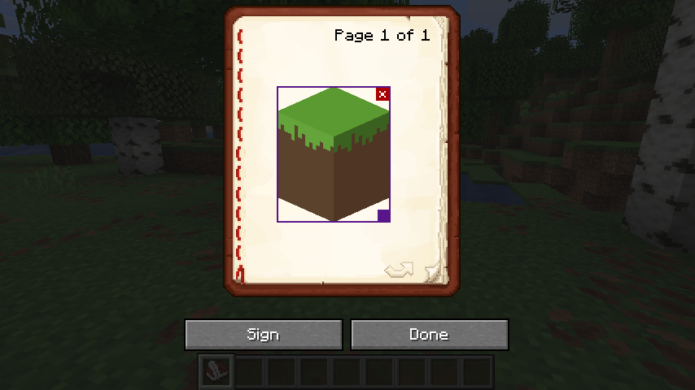
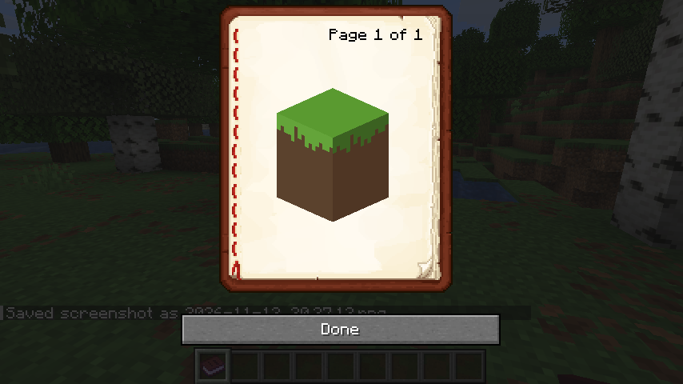

# Book Images

 
 

Paste images into Minecraft books, then position and resize them on the page. Images are stored with the world and can be displayed when the book is opened again.

An image placed in a Book and Quill:

The image also appears when the book is signed:

## Using the mod

This version supports Minecraft Java Edition 26.3 on Fabric and NeoForge and requires Java 25.

1. Copy an image to your clipboard, or copy a PNG file.
2. Open a Book and Quill and press **Ctrl+V** (or your system's paste shortcut).
3. Drag the image to move it. Drag the lower-right handle to resize it; hold **Alt** while resizing to change its proportions freely.
4. Hover over the image and click the red **X** to remove it. Close the book to save your changes.

Images belong to the page on which they were pasted. The mod uploads them to the world in PNG format; the encoded image must be smaller than approximately 32 MiB. World backups should include the `book_images` folder in the world directory.

## License

[GNU GPL v3](LICENSE).
